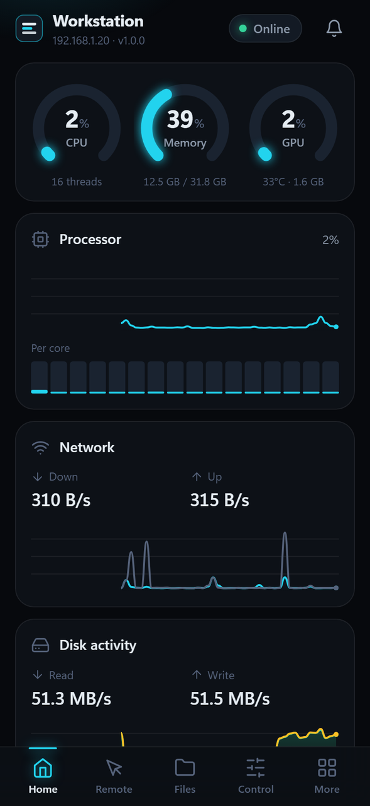
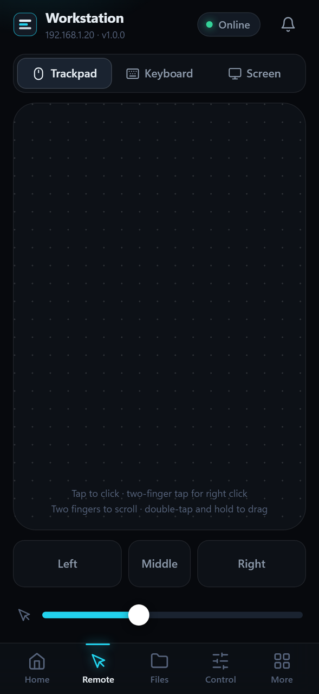
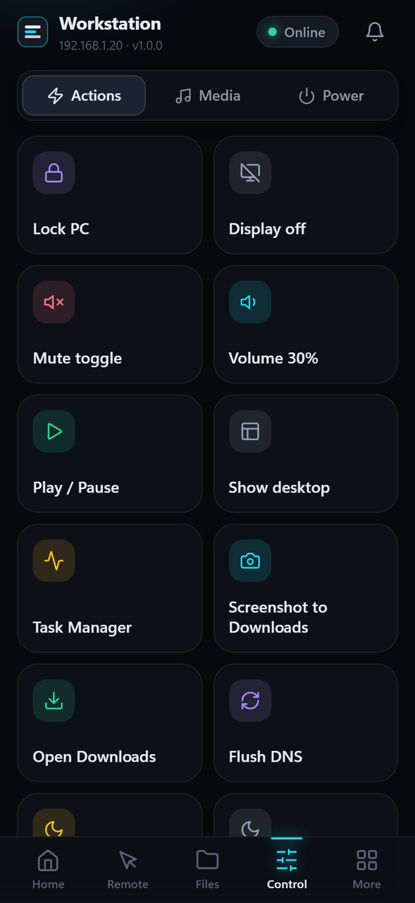

<p align="center">
  
</p>

<h1 align="center">LanDeck</h1>

<p align="center">Control your Windows PC from your iPhone over the local network.<br>
One small agent on the PC, a fast web app on the phone. No cloud, no app store, no Mac.</p>

<p align="center">
  
  
  
</p>

---

## What it does

LanDeck is a single `LANDECK.exe` that sits in the tray, starts with Windows (elevated, without a UAC prompt every time)
and serves a mobile web app over HTTPS on your LAN. Open it in Safari, add it to the Home Screen, and it behaves like
an app.

- **Dashboard** – CPU (per core), memory, disks, network and disk speed, NVIDIA GPU, battery, uptime, top processes,
  the active window. Ring gauges and 60-second sparklines, alerts when the PC is struggling.
- **Remote** – a proper trackpad (tap, two-finger right click and scroll, tap-and-drag, three-finger swipes), a
  keyboard with sticky modifiers, F-keys and common shortcuts, and a live screen view you can pinch, pan and tap to click.
- **Files** – browse shared folders, thumbnails, previews, resumable chunked uploads, ranged downloads (video seeking
  works), folders as zip, rename/delete (to the Recycle Bin), open on PC, search.
- **Control** – power (lock, display off, sleep, restart, shut down, schedules with a countdown), volume and a per-app
  mixer, media keys and now playing, output device switching, and a grid of quick actions you define on the PC.
- **Clipboard** – two-way sync, history with pins and search, images both ways, passwords masked until tapped.
- **Processes & apps** – sortable live list, end tasks (critical system processes are protected), launch Start Menu
  apps, open links on the PC, send a notification to the PC.
- **Terminal** – an admin PowerShell, off by default, behind a PIN.

It reconnects by itself after sleep, Wi-Fi drops, IP changes and agent restarts, and stays usable on a flaky network.

## Quick start

1. Download `LANDECK.exe` (or build it, see below) and run it. Windows asks for admin rights once.
   A tray icon appears; LanDeck registers itself to start at sign-in.
2. Click the tray icon → **Pair new device**. A QR code and a 6-digit code show up in the browser.
3. Scan the QR with the iPhone camera and open the link. Safari warns about the certificate the first time:
   **Show Details → visit this website → Visit Website**.
4. Give the phone a name and tap **Pair**. On the PC, click **Yes** in the box that pops up.
5. In Safari: **Share → Add to Home Screen**. Open LanDeck from the Home Screen from now on.

Phone and PC need to be on the same network, and Windows needs that network set to **Private**
(Settings → Network & internet → your network → Network profile type). The admin page warns you if it isn't.

### Getting rid of the certificate warning (optional)

The pairing page and the admin page have a link to a configuration profile (`/ca.mobileconfig`). Install it on the
iPhone, then switch it on under **Settings → General → About → Certificate Trust Settings**. The warning disappears and
the app works offline-first. The certificate authority is generated on your PC and is limited to `.local` names and
private IP ranges, so it can't be used to impersonate real websites.

## Security

LanDeck is remote control of an admin session, so it is careful about who gets in:

- HTTPS only, with a certificate generated on first run and re-issued when the PC's addresses change.
  The SHA-256 fingerprint is shown in the admin page.
- Requests from anything that isn't a private LAN or loopback address are refused.
- Pairing needs a one-time code that expires after 2 minutes **and** a click on the PC.
- Each phone gets its own 256-bit token; only a hash is stored. Revoking a phone cuts its live connection immediately.
- Five wrong tokens from an address in a minute block it for five minutes.
- The admin page and every security setting only work from the PC itself.
- Power, deleting files, ending processes and the terminal need a press-and-hold on the phone and an explicit
  confirmation in the API. All of it lands in the audit log.
- Files are limited to folders you share (Downloads, Desktop, Documents, Pictures, Videos by default), with checks
  against `..`, links and junctions escaping them.
- Quick actions are defined on the PC. The phone can only press them by id; programs run without a shell.
- The terminal is off until you enable it in the admin page and set a PIN; sessions lock after 30 minutes idle.

Do not port-forward LanDeck to the internet. It is built for your home network.

## Admin page

Tray → **Open admin** (or `https://localhost:8765/admin` on the PC): paired devices with last seen and revoke, pairing
QR, feature switches, shared folders, quick action editor, terminal PIN, audit log with filters, startup toggle,
certificate fingerprints, restart and a diagnostics export (no tokens inside).

## Command line

```
LANDECK.exe              run the agent (tray icon)
LANDECK.exe --install    start at sign-in via Task Scheduler (elevated, no UAC prompt) + firewall rules
LANDECK.exe --uninstall  remove the startup task and firewall rules   (--purge also deletes settings)
LANDECK.exe --status     elevation, task state, port, version
```

Settings, certificates, paired devices and the audit log live in `%LOCALAPPDATA%\LanDeck`.

## Building from source

Needs Windows 10/11 and Python 3.12.

```powershell
powershell -ExecutionPolicy Bypass -File build.ps1
```

That creates `.venv`, installs dependencies, draws the icons if they're missing and produces:

- `dist\LANDECK.exe` – one file, asks for admin when started
- `dist\LANDECK-onedir.zip` – the same app unpacked into a folder; starts faster and trips antivirus less often

Running from source while working on it:

```powershell
python -m venv .venv
.venv\Scripts\pip install -r requirements-dev.txt
.venv\Scripts\python -m agent.main --dev       # no tray, no elevation, web files served uncached
.venv\Scripts\python -m pytest                 # tests run in dry-run mode, nothing gets shut down
```

`tools/screens.py` takes screenshots of every view at iPhone size, `tools/smoke_ui.py` checks reconnecting and the live
screen in a real browser, `tools/upload_check.py` pushes a 500 MB file through a dropped connection and compares hashes.

### Project layout

```
agent/            the Windows agent (FastAPI + uvicorn)
  main.py         CLI, single instance, startup of server/tray/listeners
  server.py       HTTP + WebSocket, LAN-only guard, static files
  security.py     devices, tokens, pairing, rate limiting, audit log, signed links
  tls.py          local CA and server certificate
  admin.py        localhost-only admin API
  modules/        system, power, clipboard, files, media, inputctl, screen, processes, actions, notify, terminal
web/              the phone app: vanilla ES modules, no build step, works fully offline
tests/            pytest suite (dry run) and MANUAL.md checklist
tools/            icon generator, screenshot and smoke-test helpers
```

## Troubleshooting

- **The phone can't connect.** Check that both are on the same Wi-Fi, the network is Private in Windows, and that
  `https://<pc-ip>:8765` opens in Safari. Guest networks often isolate devices from each other.
- **The address changed.** Try `https://landeck.local:8765`, or reserve an IP for the PC in your router.
  If the app reached the PC on a new address it offers to move over.
- **Windows Defender or SmartScreen flags the exe.** A PyInstaller exe that controls the PC and asks for admin looks
  suspicious to heuristics; it's a known false-positive class and the exe isn't code-signed. Add an exclusion for the
  folder, or use the onedir zip, which is flagged less often. You can also build it yourself from this source.
- **Sleep doesn't work.** Some laptops only support Modern Standby; LanDeck turns the display off, which is how those
  machines go to sleep.
- **Nothing happens when I type into an admin window.** Make sure the agent runs elevated (the admin page says so).
- **Logs.** `%LOCALAPPDATA%\LanDeck\landeck.log`, or export diagnostics from the admin page.

## Known limitations

- No control at the lock screen or before sign-in, and the agent stops while the PC sleeps or hibernates.
  Wake-on-LAN is out of scope, but the Settings screen shows the PC's MAC address for a separate WoL app.
- First visit shows a certificate warning until the profile is trusted; Safari won't register the service worker
  (offline shell) before that.
- iOS doesn't run web apps in the background: the live view pauses when you leave the app and resumes when you return.
- Per-app volume, now playing, GPU stats and output switching depend on what the hardware and Windows expose and hide
  themselves when unavailable. GPU stats need an NVIDIA card (`nvidia-smi`).
- Night Light has no public API; the default action opens its settings page instead.
- The terminal is a pipe, not a full console: interactive programs that wait for keyboard input won't work.
- UAC prompts and Ctrl+Alt+Del live on the secure desktop, which no app can control.
- The exe isn't code-signed.

## Credits

Made and maintained by **TK NiRMAL**. Released under the MIT License.
